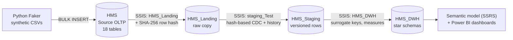

# Hospital Management System — Data Warehouse (SQL Server + SSIS)

An end-to-end batch data warehouse for a hospital, built on **Microsoft SQL Server** and **SSIS** during the
Jadara Solutions data engineering internship (Sep–Oct 2024). Data moves through four layers:
**Source (OLTP) → Landing → Staging → Data Warehouse**. Each run loads only new and changed rows, using
hash-based change detection. Staging keeps full row history, and the warehouse is a Kimball dimensional model
built for analytics and BI reporting.

---

## Architecture



| Layer | Database | Purpose |
|---|---|---|
| Source | `HMS` | Operational (OLTP) hospital database: patients, registrations, appointments, operations, treatments, lab tests, invoices, insurance, pharmacy, employees, doctors, nurses, departments, rooms, attendance… |
| Landing | `HMS_Landing` | Raw, minimally transformed copy of the source. Every row gets a **SHA-256 hash** of its business columns. |
| Staging | `HMS_Staging` | Cleaned and **versioned** data. Detects new, changed and deleted rows and keeps history. |
| Data Warehouse | `HMS_DWH` | **Kimball star schemas**, organized by subject area, with surrogate keys and a date dimension. |

---

## Incremental loading with hash-based change detection

Instead of reloading or comparing every column, each row is reduced to one fingerprint.

1. **Landing:** a C# Script Component concatenates the row's business columns and computes a **SHA-256 hash**
   (`HashCode`), stored with the row.
2. **Staging:** each incoming row goes through two lookups:
   - **Business-key lookup:** the key isn't in staging yet → **new** row, inserted as current.
   - **Hash lookup:** the key exists but the hash differs → **updated** row. The old version is closed
     (`IsLatest = 'N'`, `EndDate = GETDATE()`) and the new version is inserted as current.
   - **Deleted rows:** current staging rows whose key no longer exists in the source are **soft-deleted**
     (`RowStatus = 'D'`), so history is never lost.
3. **Data warehouse:** packages read only current, non-deleted staging rows
   (`IsLatest = 'Y' AND RowStatus <> 'D'`) and use the hash to skip rows the warehouse already holds.

Every versioned table carries the same audit columns:
`HashCode, LandingDate, StartDate, EndDate, IsLatest, RowStatus`. This is an **SCD Type 2**-style history.

---

## Dimensional model

The warehouse is split into **subject-area schemas** that share **conformed dimensions**:

| Schema | Fact table | Grain / measures | Dimensions |
|---|---|---|---|
| `Inv` (billing) | `Inv.FactInvoice` | invoice line: amount, coverage %, quantity | Patient, Invoice, Appointment, Insurance, Pharmacy (medicine), Operation, Department, Date |
| `Op` (operations) | `Op.FactOperation` | one operation: **duration (min)**, **patient age**, price | Patient, Employee (doctor), Operation, Department, Room, Date |
| `Att` (HR) | `Att.FactAttendance` | employee day: check-in/out, working hours | Employee, Date |
| `Shared` | — | conformed dimensions | `DimPatient`, `DimEmployee`, `DimDepartment`, `DimOperation`, `DimDate` |

- **Surrogate keys** (`BIGINT IDENTITY`) on every dimension, with **foreign keys** from the facts.
- **`DimDate`** is generated by script for 1920–2100, with day, week, month, quarter and year attributes,
  weekday/weekend flags and a holiday flag. Date keys use the `yyyymmdd` format.
- Fact-loading queries join current staging rows, resolve keys and **derive measures**. For example,
  `FactOperation` computes operation duration with `DATEDIFF(MINUTE, start_time, end_time)` and patient age at load time.

---

## Data validation

`SQL Scripts/Measures_TestCases.sql` holds **reconciliation tests**. The same business measures (patient
counts, patients by admission reason, by prescription, by blood type, …) are computed in **Source, Landing and
Staging** (current rows only), so the results can be compared to prove nothing was lost or duplicated between layers.

---

## Synthetic data

Realistic hospital data (~163K rows across 18 entities, e.g. 40K appointments, 27K attendance records,
20K medical-history records, 10K patients) was generated with **Python Faker**, exported to CSV and loaded with
`BULK INSERT`. Extra SQL scripts make it consistent, e.g. aligning operations with departments and spreading
operations across doctors.

---

## Repository structure

```
Dummy Data/          CSV files for the source database (generated with Python Faker)
SQL Scripts/
  Create SrcDB.sql            source (OLTP) database
  SrcBulkInsert.sql           BULK INSERT of the CSVs
  Create LandingDB.sql        landing database
  Create StagingDB.sql        staging database (with history/audit columns)
  Create DWH V2.sql           data warehouse: schemas, dimensions, facts, DimDate (latest version)
  DML_DimCalendarDate.sql     date dimension population
  Select Statments DWH.sql    source queries used to load dimensions and facts
  Measures_TestCases.sql      cross-layer reconciliation tests
  Align Operation with Dept.sql, drop and add constraints.sql   data-consistency helpers
SSIS Repos/
  HMS_Landing/     Source → Landing packages (one per table, plus TruncateTables) with SHA-256 hashing
  staging_Test/    Landing → Staging packages (new / updated / deleted detection, history)
  HMS_DWH/         Staging → DWH packages (Dim*.dtsx, Fact*.dtsx)
```

## How to run

1. Run `Create SrcDB.sql`, then `SrcBulkInsert.sql` (update the CSV paths).
2. Run `Create LandingDB.sql`, `Create StagingDB.sql` and `Create DWH V2.sql`, then populate `DimDate`.
3. Open the SSIS solutions in Visual Studio (SQL Server Integration Services Projects). Update the server name in
   `Project.params` / connection managers, then run them in order: **HMS_Landing → staging_Test → HMS_DWH**
   (dimensions before facts).
4. Run `Measures_TestCases.sql` to reconcile the layers.

## Tech stack

Microsoft SQL Server · T-SQL · SSIS (≈50 packages) · C# Script Component (SHA-256) · Python Faker · Kimball dimensional modelling

## Team

Built by a team of interns at **Jadara Solutions** (2024):

- **Ahmed Emad** ([@ahmedemad2002](https://github.com/ahmedemad2002)): data warehouse design and implementation (dimensional model, DWH schema and constraints, SSIS dimension and fact load packages, transformation queries)
- **[@sayedzayan](https://github.com/sayedzayan)**: staging layer (incremental/history logic), validation queries, DWH error handling
- **Mohamed El3omda**: source database, synthetic data, landing layer
- **Amr**: source data consistency scripts
- **Youssef Hegazy** ([@YoussefHegazy07](https://github.com/YoussefHegazy07)): landing packages
- **[@Arwa45](https://github.com/Arwa45)**: semantic model (SSRS) and Power BI dashboards
